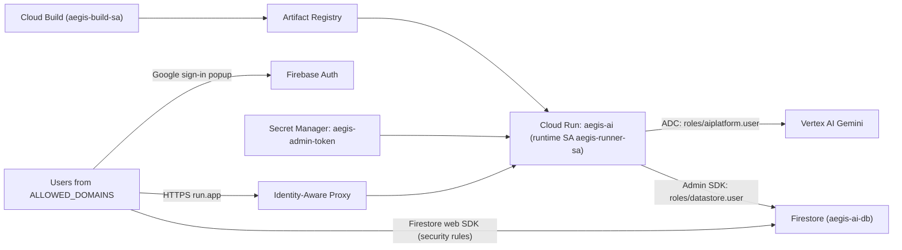

# AegisAI on Google Cloud (Argolis) — Deployment Runbook

How to run AegisAI on **Cloud Run** inside an Argolis organization (`<ldap>.example.com`). Access is limited to Google accounts from specific email domains, and the deployment is **keyless**: no API keys or service-account keys.

Everything is scripted and idempotent:

| Step | Command | Changes anything? |
|---|---|---|
| Check readiness | `scripts/argolis/preflight.sh` | No (read-only) |
| One-time project setup | `scripts/argolis/bootstrap.sh` | Yes, additive only |
| Build + deploy | `./deploy_cloud_run.sh` | Yes |

## Architecture



**Who can access what:**
- **IAP** controls who can reach the service at all, including UI, API and static files.
- **Firestore security rules** protect the data that browsers read directly (audits, catalogs, API keys). IAP does not cover Firestore, so the rules restrict access to the same domains.
- **The server** uses the Firebase **Admin SDK** as `aegis-runner-sa`, which isn't subject to the rules.

## Prerequisites
- `gcloud` (logged in as an Owner of the project), `curl`, `python3`, `openssl`. Cloud Shell has all of them.
- Firebase is enabled on the project, with a registered Web app.
- `gcloud auth login` and `gcloud config set project <PROJECT_ID>`.

## Step 0 — Firebase Auth checks (console, one time)
1. **Firebase → Authentication → Sign-in method:** set **Google** to *Enabled* and set the support email.
2. **Google Auth Platform → Audience:**
   - User type: **External**. With *Internal*, only your Argolis org can sign in, and `@google.com` users get `Error 403: org_internal`.
   - Publishing status: **In production**. Don't upload a logo; that triggers verification.
3. **Firebase → Authentication → Settings → Authorized domains:** this lists **hosting origins**, not user email domains. Remove `google.com` and `cloudshell.dev` if present. The deploy script adds the Cloud Run hostnames automatically.

## Step 1 — Configure
```bash
cp scripts/argolis/config.env.example scripts/argolis/config.env   # gitignored
```
Set `PROJECT_ID`, `ALLOWED_DOMAINS` (exact email domains, e.g. `sandbox.example.com,google.com`), `FIRESTORE_DATABASE_ID` and `ACCESS_MODE` (`iap` recommended). `firestore.rules` must list the same domains in `isAllowedUser()`; the scripts check this.

## Step 2 — Preflight (read-only)
```bash
scripts/argolis/preflight.sh
```
This reports identity, billing, APIs, **effective org policies**, Firebase/Auth setup, Firestore rules drift, service accounts, the secret, and the current Cloud Run settings.

## Step 3 — Bootstrap (once per project)
```bash
scripts/argolis/bootstrap.sh
```
What it does:
- Enables APIs.
- Creates `aegis-build-sa` with `cloudbuild.builds.builder`, `logging.logWriter`, and `artifactregistry.writer` on the repo.
- Grants `aegis-runner-sa` the roles `aiplatform.user` and `datastore.user`. It gets `viewer` only if `ENABLE_LIVE_SCANNER_ADC=true`.
- Generates the `aegis-admin-token` secret and creates the Firestore database if missing.
- Writes `firebase-applet-config.local.json` from the Firebase Management API if missing.

`--prune-legacy-roles` removes the broad roles that older scripts granted to the default Compute SA. It asks for confirmation first.

## Step 4 — Deploy
```bash
./deploy_cloud_run.sh
```
The script:
1. Builds with Cloud Build, passing the frontend's build-time settings.
2. Publishes `firestore.rules`.
3. Deploys Cloud Run with these settings:
   - Runtime SA, `GOOGLE_GENAI_USE_ENTERPRISE=true` (Vertex AI), `--set-secrets ADMIN_API_TOKEN`
   - `--max-instances 1 --no-cpu-throttling --timeout 3600 --cpu 2 --memory 2Gi`
4. Sets up access:
   - **IAP:** binds `roles/iap.httpsResourceAccessor` to each `domain:` in `ALLOWED_DOMAINS` and gives the IAP service agent `run.invoker`.
   - **Public:** uses `--no-invoker-iam-check` instead.
5. Adds the service hostnames to Firebase *Authorized domains*.
6. Runs a smoke test.

| Variant | Command |
|---|---|
| Redeploy the current image (e.g. after changing access) | `SKIP_BUILD=1 SKIP_RULES=1 ./deploy_cloud_run.sh` |
| Public URL with in-app sign-in only | `ACCESS_MODE=public ./deploy_cloud_run.sh` |

## Step 5 — IAP for domains outside your org (console, one time)
IAP's default (Google-managed) OAuth client only admits identities **inside** your organization. To admit `@google.com` or another external domain:

1. **Set the audience.** In [Google Auth Platform → Audience](https://console.cloud.google.com/auth/audience), set User type to **External** and publishing status to **In production**.
2. **Switch IAP to a custom client.** Open **Cloud Run → aegis-ai → Security → Identity-Aware Proxy → Configure in IAP**. Under **OAuth configuration**, select **Custom OAuth**, then **Save**:
   - If offered, click **Auto generate credentials**.
   - Otherwise, create a *Web application* client under Google Auth Platform → Clients. Add the redirect URI `https://iap.googleapis.com/v1/oauth/clientIds/CLIENT_ID:handleRedirect`, then paste the client ID and secret into the IAP page.

`deploy_cloud_run.sh` grants the `domain:` access and reports whether a custom client is active. It reads the client ID from IAP's sign-in redirect, because console-created clients don't appear in `gcloud iap settings get`.

Users sign in twice: IAP first, then the app's **"Iniciar sesión con Google"** button.

## Operating
- **Admin panel token:** `gcloud secrets versions access latest --secret aegis-admin-token --project <PROJECT_ID>`. To rotate it, add a new secret version and redeploy.
- **Logs:** `gcloud run services logs read aegis-ai --region us-central1 --project <PROJECT_ID> --limit 100`
- **Roll back:** `gcloud run revisions list --service aegis-ai --region us-central1`, then `gcloud run services update-traffic aegis-ai --region us-central1 --to-revisions <REVISION>=100`
- **Model:** set `GEMINI_MODEL` in `config.env` and redeploy. The Admin panel can change it at runtime until the instance restarts.

## Configuration reference
| Setting | Where | Purpose |
|---|---|---|
| `ALLOWED_DOMAINS` | config.env, build arg `VITE_ALLOWED_DOMAINS` | IAP grants, in-app sign-in allow-list (exact domain), rules check |
| `ACCESS_MODE` | config.env | `iap` (only allowed domains reach the service) or `public` |
| `ENABLE_DEMO_MODE` | config.env, build arg `VITE_ENABLE_DEMO_MODE` | Shows the demo button that **skips sign-in**. Keep `false`. |
| `ENABLE_LIVE_SCANNER_ADC` | config.env, runtime env | Disabled (`false`) by default to enforce `C05.2` least privilege (`aegis-runner-sa` holds only `aiplatform.user` and `datastore.user`; Live Scanner uses ephemeral caller tokens) |
| `GOOGLE_GENAI_USE_ENTERPRISE`, `GOOGLE_CLOUD_PROJECT`, `GOOGLE_CLOUD_LOCATION`, `GEMINI_MODEL` | runtime env | Gemini on Vertex AI through ADC |
| `FIRESTORE_DATABASE_ID` | config.env, runtime env | Database used by the server's Admin SDK |
| `ADMIN_API_TOKEN` | Secret Manager | Protects `/api/admin/*` |

## Argolis org policies and how this deployment handles them
| Policy | Effect | Handling |
|---|---|---|
| `iam.allowedPolicyMemberDomains` (domain restricted sharing) | Blocks `allUsers` and external `domain:` grants | IAP grants need it open for external domains. Public mode uses `--no-invoker-iam-check`, which doesn't need `allUsers`. |
| `iam.automaticIamGrantsForDefaultServiceAccounts` | Default SAs have no roles, so Cloud Build fails | Dedicated `aegis-build-sa` / `aegis-runner-sa` with explicit roles |
| `iam.disableServiceAccountKeyCreation` | No SA keys | Keyless: ADC everywhere |
| `compute.requireShieldedVm`, `compute.vmExternalIpAccess` | Block simple VMs | Not used (Cloud Run) |

## Troubleshooting (errors seen during the first Argolis attempt)
| Error | Cause | Fix |
|---|---|---|
| `Build failed because the default service account is missing required IAM permissions` | Default SAs have no roles in Argolis | `bootstrap.sh` creates `aegis-build-sa`; the deploy script builds with it |
| `One or more users named in the policy do not belong to a permitted customer` | Domain restricted sharing | Use IAP with the policy open, or `ACCESS_MODE=public` |
| `Policy and Constraint must be of the same type` | `disable-enforce` used on a list constraint | Not needed by these scripts |
| `403 Forbidden ... /api/evaluate` | Cloud Run IAM invoker check with browser traffic | IAP (browser sign-in) or `--no-invoker-iam-check` |
| `This instance's domain is not yet registered in ... Authorized Domains` | Cloud Run host missing in Firebase Auth | Added automatically by `deploy_cloud_run.sh` |
| `Error 403: org_internal` at Google sign-in | OAuth audience is *Internal* | Google Auth Platform → Audience → **Make external** |
| `API_KEY_SERVICE_BLOCKED` on `aiplatform.googleapis.com` | An API key sent to Vertex AI | Fixed in code: the backend flag is explicit; Vertex mode uses ADC |
| `PERMISSION_DENIED` writing audits/frameworks | Rules deny the unauthenticated client SDK | Server now uses the Admin SDK; `firestore.rules` published by the deploy script |
| Container failed to listen on `PORT=8080` | Reserved `PORT` env var / startup crash | `PORT` is no longer set; check `gcloud run services logs read` |

## Known limitations
- **Admin settings are kept per instance.** They live on the instance filesystem, so the service runs with `--max-instances 1` and runtime changes reset on restart. Deploy-time settings come from env vars.
- **Upload size:** 30 MB per file (Cloud Run caps HTTP/1 request bodies at 32 MiB).
- **IAP session expiry:** when the IAP session expires, reload the page.
- **The Live Scanner's ADC mode is disabled by default.** Token, service-account and demo modes remain available.
