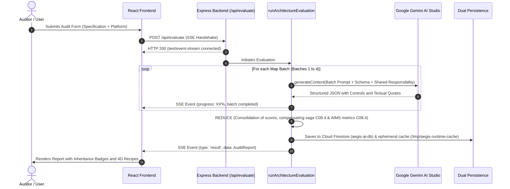
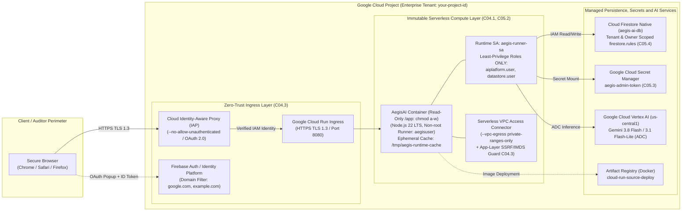

# AEGIS AI ASSURANCE PLATFORM
## Software Architecture Document (SAD)
**Version:** 2.5.0 Enterprise (2026 Edition)  
**Documentation Standard:** Based on IEEE 1471 / ISO/IEC 42010 and the 4+1 View Model  
**Classification:** Technical Architecture and Design Document for Principal Engineers and Auditors

---

## 1. Introduction and Architectural Goals

### 1.1 Purpose
This document formally describes the software architecture of **AegisAI**, a mission-critical platform focused on quality assurance, cybersecurity, and regulatory compliance in Generative Artificial Intelligence and Machine Learning systems.

### 1.2 Core Quality Attributes
1. **Deterministic Hyper-Factuality (QA-01):** Zero tolerance for hallucinations. The AI must evaluate exclusively based on the provided documentary evidence, rejecting unsupported inferences.
2. **Complete Output Capacity Without Truncation (QA-02):** The ability to audit over 40 comprehensive technical controls without exceeding the strict 8,192-token output limit per LLM call.
3. **Immutability and Forensic Traceability (QA-03):** Compliance with OWASP AI-SVS Invariant 4: audit logs cannot be altered or deleted once adjudicated.
4. **Resiliency and High Availability (QA-04):** Fault tolerance against transient network drops, cloud provider quota limits, or model saturation.
5. **Performance and Low Latency (QA-05):** Legal framework ingestion and real-time processing with sub-second latencies on structured tasks.

---

## 2. Design Patterns and Architectural Decisions

### 2.1 Map-Reduce Pattern for Distributed Inference
- **Problem:** Contemporary LLM models feature massive input windows (1M to 2M tokens), but maintain a rigid generation limit (**completion tokens**) of 8,192 tokens. Attempting to audit 12 chapters (44 controls) with complete mitigation recipes in a single request causes the model to severely compress or truncate its responses.
- **Solution:** A Map-Reduce architecture was implemented in `server.ts`:
  - **MAP Phase:** Standard chapters are partitioned into 3 or 4 parallel batches (e.g., Batch 1: C01-C03; Batch 2: C04-C06; Batch 3: C07-C09; Batch 4: C10-C12). Each batch is sent independently to the LLM with the strict structured schema.
  - **REDUCE Phase:** The orchestrator unifies the result matrices in memory, calculates the overall weighted score, and consolidates non-conformities into the final `AuditReport` object.

### 2.2 Server-Sent Events (SSE) Streaming Pattern
- **Problem:** A comprehensive technical evaluation of over 40 controls takes between 20 and 45 seconds. A traditional synchronous HTTP call would cause UI freezes or proxy timeouts.
- **Solution:** The `/api/evaluate` route operates under the SSE protocol (`text/event-stream`), dispatching granular progress events (`{ type: 'progress', progress: 50, message: '...' }`) and keeping the connection alive with `: keep-alive\n\n` heartbeats every 12 seconds.

### 2.3 Immutable Container Filesystem & Resilient Cloud Persistence Pattern (`C04.1`)
- **Problem:** Writing runtime configuration or user-ingested regulatory frameworks directly into the container's `/app/config` directory violates immutable infrastructure principles (`OWASP AI-SVS C04.1`) and creates a local privilege-escalation / persistence vector if an application dependency is compromised.
- **Solution:** The production `Dockerfile` seals the entire `/app` directory tree as strictly read-only (`RUN chmod -R a-w /app`) for the non-root execution identity (`aegisuser`, UID `10001`). Runtime state (`admin-settings.json` and dynamically ingested custom frameworks) is persisted authoritatively in **Google Cloud Firestore** (`system_config/admin_settings` and `custom_frameworks/{id}`) and cached only in the isolated ephemeral volume `/tmp/aegis-runtime-cache` (`AEGIS_RUNTIME_CACHE_DIR`), ensuring zero mutation of the container image layers while preserving high availability.

### 2.4 Shared Responsibility Deduplication Pattern
- **Problem:** In architectures deployed on Google Gemini Enterprise SaaS, penalizing the client for failing to prove how model weights are encrypted on physical TPU hardware is an audit error that misdirects attention away from application security.
- **Solution:** The evaluation engine incorporates automated logic to filter out infrastructure provider responsibilities (such as physical hardware security, cloud-level data centers, and multi-tenant isolation), focusing exclusively on the customer-controlled application layer (prompts, RAG, filters, API security, and governance).

### 2.5 Multi-Provider Decoupling and Universal Inference Pattern
- **Problem:** Forcing an exclusive dependency on a single AI provider (vendor lock-in) prevents corporate clients from utilizing their existing agreements with OpenRouter, OpenAI, or local inference servers (vLLM, Ollama, LiteLLM).
- **Solution:** A decoupled engine centered around `executeAIWithFallback` was implemented:
  - If the configured provider is `gemini`, it utilizes the `@google/genai` SDK via Vertex AI Application Default Credentials (`aegis-runner-sa`) with its resiliency hierarchy (`gemini-3.8-flash` -> `gemini-3.1-flash-lite` -> `gemini-3.7-flash`).
  - If the provider is `openrouter`, `openai`, or `custom_openai_compatible`, it enforces outbound SSRF & host allowlist validation (`validateOutboundEndpoint` — blocking RFC 1918 private IPs, loopback, and cloud metadata `169.254.169.254`) and utilizes a native HTTPS client implementing `/v1/chat/completions` with 180s `AbortController` timeouts, exponential backoff, strict JSON extraction, and token accounting.

### 2.6 Remediated Architecture Generation Pattern (Drop-in Replacement)
- **Problem:** Providing a client solely with a report containing failing scores or non-conformity lists does not resolve the technical gap and creates operational friction.
- **Solution:** When failures or missing evidence are detected, the system orchestrates a synthetic remediation phase. The engine takes the user's original architecture and weaves in all missing safeguards (anti-injection sanitization, DLP anonymization, RAG isolation, immutable logs, and human scaling), producing a production-ready Markdown document (`.md` / `.txt`) that guarantees **100.0% regulatory compliance**.

### 2.7 Simultaneous Multi-Framework Orchestration Pattern (Compliance 360°)
- **Problem:** In production environments and regulated sectors (banking, retail, healthcare), an AI system must simultaneously satisfy multiple regulatory layers: technical cybersecurity (OWASP AI-SVS 1.0), AI governance and risk management (ISO/IEC 42001:2023), data privacy (LFPDPPP / INAI), and commercial transparency (LFPC / PROFECO). Executing fragmented audits multiplies latency and creates reporting silos.
- **Solution:** `runArchitectureEvaluation` supports the concurrent specification of multiple regulatory frameworks via `selectedStandards: string[]`. During the MAP phase, the engine aggregates batches from all selected standards, injecting lineage metadata (`standardId`, `standardName`, `contextText`) into each inference block. In the REDUCE phase, the system calculates the global metric and structures the `standardsBreakdown` array, where each standard preserves its independent score (0-100%), total evaluated controls, and compliance status, allowing for the rendering of Compliance 360° dashboards and the export of consolidated executive reports.

### 2.8 Live Cloud Infrastructure Inspection Pattern (GCP Live Scanner - Zero-Footprint)
- **Problem:** Auditing exclusively static documents or written diagrams introduces human bias ("wishful thinking" or discrepancies between specification and actual implementation). Likewise, deploying software agents or functions within the client's project generates friction with corporate cybersecurity areas due to cost, stability risks, and approval processes.
- **Solution:** The `gcpScannerService` was designed to interact exclusively with the **Google Cloud Control Plane (Management APIs)** via read-only `HTTP GET` queries using caller-supplied ephemeral OAuth Bearer tokens or read-only service account credentials in memory (never persisting keys to disk and never granting `roles/viewer` to the Cloud Run runtime service account `aegis-runner-sa`). It inspects critical configurations of Cloud IAM, Vertex AI, Cloud Run, Cloud Storage, and Secret Manager, synthesizing a structured technical manifest (`<gcp_live_infrastructure_manifest>`) that feeds directly into the multi-normative Map-Reduce engine, guaranteeing a live cloud-reality-based audit with **zero footprint and zero resources created on the client side**.

---

## 3. Logical Component View

```mermaid
flowchart TD
    subgraph ClientLayer ["Client Layer (SPA Frontend)"]
        UI["React 19 + Tailwind CSS v4\nView-based Code-Splitting"]
        SSE_Client["SSE Event Consumer\nReactive Streaming"]
        PDF_Engine["jsPDF + AutoTable\nDynamic On-Demand Loading"]
        RemediationUI["Remediated Architecture\nPreview & Download Modal"]
    end

    subgraph GatewayLayer ["Routing & Security Layer (Express)"]
        SecHeaders["OWASP Headers & DNS Rebinding Guard\n(nosniff, SAMEORIGIN, Host Allowlist C10.5)"]
        DotfileBlocker["Anti-Probing & Anti-DoW Filter\n(/.env Block, Rate & Token Quotas C11.1)"]
        AuthMiddleware["Zero-Trust RBAC & Identity Context\n(crypto.timingSafeEqual, Firebase ID Token, IAP C05.3)"]
    end

    subgraph CoreEngine ["Multi-Provider AI Evaluation Core"]
        Orchestrator["runArchitectureEvaluation\n(Map-Reduce + Compensating Saga C09.4)"]
        Decomposer["decomposeLegalDocument\n(Universal BYOF Engine + SHA-256 C01.4)"]
        Remediator["remediatedArchitectureGenerator\n(100% Compliance Synthesis)"]
        Dispatcher["executeAIWithFallback\n(180s Timeout + responseLogprobs:false C11.4)"]
        GeminiClient["Google GenAI SDK (Vertex AI ADC)\n(503/429 Fallback Chain)"]
        UniversalOpenAI["Universal /v1/chat/completions Client\n(SSRF Guard C04.3 + TLS 1.3)"]
    end

    subgraph PersistenceLayer ["Immutable & Cloud Persistence Layer (C04.1)"]
        LocalFS["Read-Only Bundled Baselines (/app/config)\n+ Ephemeral Cache (/tmp/aegis-runtime-cache)"]
        CloudFirestore["Google Cloud Firestore (aegis-ai-db)\nCollections: audits, custom_frameworks, system_config"]
    end

    UI --> SecHeaders
    SecHeaders --> DotfileBlocker
    DotfileBlocker --> AuthMiddleware
    AuthMiddleware --> Orchestrator
    AuthMiddleware --> Decomposer
    AuthMiddleware --> Remediator
    Orchestrator --> Dispatcher
    Decomposer --> Dispatcher
    Remediator --> Dispatcher
    Dispatcher -->|gemini| GeminiClient
    Dispatcher -->|openrouter/openai/local| UniversalOpenAI
    Orchestrator --> LocalFS
    Orchestrator --> CloudFirestore
    Decomposer --> LocalFS
    Decomposer --> CloudFirestore
    Orchestrator -. SSE Events .-> SSE_Client
    Remediator -. .md Specification .-> RemediationUI
```

---

## 4. Domain and Data Models

### 4.1 `AuditReport` Entity
Representative structure of the issued technical report:
```typescript
interface AuditReport {
  id: string;                      // Unique identifier (e.g., LFPDPPP-2026-0001)
  date: string;                    // ISO 8601 timestamp
  systemName: string;              // Name of the audited system
  technicalLead: string;           // Responsible technical lead
  email: string;                   // Contact email
  description: string;             // Evaluated technical specification
  standard: 'AI-SVS' | 'ISO-42001' | 'FULL' | 'CUSTOM';
  customFrameworkId?: string;      // Custom law ID if standard === 'CUSTOM'
  customFrameworkName?: string;    // Descriptive name of the regulation
  targetLevel: 'L1' | 'L2' | 'L3' | 'AUTO';
  assessedLevel: 'L1' | 'L2' | 'L3';
  levelAssessmentRationale: string;// Technical justification for the level
  techPlatform: string;            // gemini-enterprise, vertex-ai, self-hosted
  techPlatformName: string;        // Commercial name of the platform
  deploymentType: 'SaaS' | 'PaaS' | 'IaaS' | 'Self-Hosted';
  overallScore: number;            // Weighted score (0-100%)
  executiveSummary: string;        // Executive summary of risks
  chapters: StandardChapter[];     // Evaluated chapters with their tested points
  modelUsed: string;               // Exact Gemini model used
  latencyMs: number;               // Total inference time
  promptTokens: number;            // Input tokens
  completionTokens: number;        // Generated output tokens
}
```

### 4.2 `PuntoProbado` Entity and 4D Mitigation Recipe
```typescript
interface PuntoProbado {
  id: string;                      // Control identifier (e.g., LFPDPPP-03.1)
  name: string;                    // Requirement title
  status: 'Aprobado' | 'Requiere Revisión' | 'Falta Evidencia' | 'No Aplica';
  findings: string;                // Findings and technical justification
  fuenteEvidencia?: string;        // Exact textual quote from the documentation
  isInheritedFromPlatform?: boolean;// True if covered by Google Cloud SaaS
  inheritedPlatformName?: string;  // Name of the accredited cloud
  level?: 'L1' | 'L2' | 'L3';      // Verification level
  isMandatoryForTargetLevel?: boolean;
  remediationDetails?: {
    strategy: string;              // Dimension 1: Architectural strategy
    actionableSteps: string[];     // Dimension 2: Step-by-step checklist
    codeOrConfigExample: string;   // Dimension 3: Real code or manifest
    verificationRecipe: string;    // Dimension 4: Pentesting script / curl QA
    effortLevel: string;           // Estimated effort (< 1 day, 1-3 days, etc.)
    recommendedTools: string[];    // Recommended libraries (Presidio, Sigstore)
  };
}
```

---

## 5. Process View: Sequence Diagrams

### 5.1 Audit Flow with Map-Reduce and SSE Streaming


---

## 6. Threat Modeling and Security

AegisAI has been subjected to and hardened against the 10 threat categories of the **OWASP Top 10 for LLM Applications** and **OWASP AI-SVS v1.0**:

| Identifier | Threat Vector | Defense Mechanism Implemented in AegisAI |
| :--- | :--- | :--- |
| **LLM01** | Prompt Injection & Multi-Turn Crescendo (`C02.10`) | Strict XML delimiters (`<user_candidate_architecture>`), deterministic parameters (`temp: 0.0`), and stateful multi-turn risk accumulator (`inspectPromptAndTrackSession`) that blocks incremental escalation across sessions with HTTP 400 and dispatches `[AEGIS_SECURITY_ALERT]` events (`C12.2`). |
| **LLM02** | Insecure Output Handling | Rigid typing in JSON schemas (`buildBatchChaptersSchema`), anchored code-fence extraction, anti-XSS sanitization in React, and secure rendering in PDF and Markdown exporters. |
| **LLM03** | Data & Knowledge Base Poisoning (`C01.4`) | Mandatory structural validation during regulatory ingestion (`frameworkDecomposerSchema`) and startup SHA-256 cryptographic verification (`verifyNormativeSnapshotsIntegrity`) against `config/frameworks/integrity-manifest.json`. |
| **LLM04** | Model Denial of Service & Denial of Wallet (`C11.1`) | Maximum payload limit in Express (`30MB` JSON/multipart with HTTP 413 rejection), plus sliding-window per-identity rate limiting (`10 req/min`), concurrent evaluation cap (`max 2 active audits/user`), and rolling 1-hour token budget (`500,000 tokens/user`) via `acquireAntiDoWQuota`, returning `HTTP 429 Too Many Requests` with `Retry-After` headers. |
| **LLM05** | Supply Chain & MCP Integrity (`C10.1`) | Minimized dependencies, lockfile enforcement (`package-lock.json`), SHA-256 normative manifest verification (`C01.4`), and HMAC-SHA256 signature + tool digest verification for Model Context Protocol (MCP) manifests (`verifyMcpManifestSignature`, `/api/mcp/verify`). |
| **LLM06** | Information Disclosure & Model Extraction (`C11.4`) | Automatic log masking (`redactSensitiveStrings`) scrubbing API keys (`AIzaSy...`, `sk-...`, Bearer tokens) and strict suppression of logit/probability distributions (`responseLogprobs: false`, `logprobs: undefined`) to prevent model distillation/extraction attacks. |
| **LLM07** | Insecure Plugin / Tool Design (`C05.3`, `C10.2`–`C10.5`) | Constant-time token comparison (`crypto.timingSafeEqual` over SHA-256 digests), Firebase ID Token & Cloud IAP identity propagation (`extractUserSecurityContext`), strict DNS Rebinding Host/Origin validation (`dnsRebindingGuard`), and outbound SSRF blocking (`validateOutboundEndpoint`). |
| **LLM08** | Excessive Agency (`C05.2`, `C09.4`) | OWASP AI-SVS Invariant 4: Audits are immutable (`allow delete: if false;`), runtime identity `aegis-runner-sa` has strictly `roles/aiplatform.user` and `roles/datastore.user` (zero `roles/viewer` or write privileges on customer infrastructure), and multi-step orchestration is wrapped in a compensating transaction saga (`runCompensatingSaga`). |
| **LLM09** | Overreliance / Hallucination (`C08.4`) | Mandatory verbatim textual evidence quotes (`fuenteEvidencia` and `textoEvidencia`); automatic downgrade to `Falta Evidencia` when quotes are absent; continuous grounding faithfulness telemetry (`recordAimsEvaluationMetrics`, target SLO $\ge 95\%$). |
| **LLM10** | Model Theft / File Probing (`C04.1`) | Read-only container filesystem (`chmod -R a-w /app`), non-root user `aegisuser`, and anti-probing middleware blocking dotfiles (`/.env`, `.key`, `.git`, `.pem`) with immediate HTTP 404. |

---

## 7. Cloud Deployment View

The AegisAI infrastructure architecture leverages the managed ecosystem of **Google Cloud Platform (GCP)** to ensure high availability (99.95%), zero server maintenance, and strict Zero-Trust network isolation:



### 7.1 Infrastructure Components and Service Mapping
| GCP Component | Technical Service | Role and Responsibility |
| :--- | :--- | :--- |
| **Zero-Trust Perimeter** | Cloud Identity-Aware Proxy (IAP) & Cloud Run | Enforces `--no-allow-unauthenticated` at the edge (`C04.3`), allowing only verified principals from authorized corporate domains (`google.com`, `example.com`). |
| **Serverless Compute** | Google Cloud Run (`aegis-ai`) | Hosts the immutable container (`chmod -R a-w /app`, non-root `aegisuser`, `C04.1`) with `--vpc-egress private-ranges-only` and outbound SSRF guard (`C04.3`). |
| **Execution Identity** | Cloud IAM (`aegis-runner-sa`) | Dedicated least-privilege Service Account granted **exclusively** `roles/aiplatform.user` and `roles/datastore.user` (`C05.2`). Project-wide `roles/viewer` is strictly prohibited. |
| **Secret Management** | Google Cloud Secret Manager | Custodies `aegis-admin-token` injected at runtime and verified in constant time via `crypto.timingSafeEqual` (`C05.3`). |
| **NoSQL Database** | Cloud Firestore Native (`aegis-ai-db`) | Stores immutable `audits`, `apiKeys`, `custom_frameworks`, and `system_config` protected by tenant/owner-bound `firestore.rules` (`C05.4`, 308 automated tests). |
| **Inference and AI** | Vertex AI (`us-central1`) | Executes deterministic Map-Reduce evaluations (`temperature: 0.0`, `responseLogprobs: false`, `C11.4`) via ADC without static API keys. |

---

## 8. OWASP AI-SVS v1.0 Comprehensive Technical Controls Specification

This section provides the explicit architectural specification and code-level verification mapping for the 17 technical security controls reinforced in AegisAI Enterprise v2.5.0:

### 8.1 `C01.4` — Cryptographic Integrity of Normative Knowledge Bases & Snapshots
- **Control Implementation:** All bundled normative baselines (`owasp-aisvs-context.md`, `iso-42001-context.md`, and `config/frameworks/*.json`) are sealed in `config/frameworks/integrity-manifest.json` with their authoritative **SHA-256** cryptographic digests and byte lengths.
- **Verification Mechanism:** On server initialization and via `GET /api/security/posture`, `verifyNormativeSnapshotsIntegrity()` computes the live SHA-256 digest of each normative file using Node.js `crypto.createHash('sha256')`. Any hash mismatch or unauthorized file mutation immediately flags a `CRITICAL` `[AEGIS_SECURITY_ALERT]` and isolates the tampered file.

### 8.2 `C02.10` — Stateful Multi-Turn & Crescendo Prompt Injection Defense
- **Control Implementation:** Beyond static single-turn regex filtering, `server.ts` implements `inspectPromptAndTrackSession(sessionKey, rawText, routeLabel)` using an in-memory sliding window (`SESSION_RISK_WINDOW_MS = 15 minutes`, `SESSION_CRESCENDO_THRESHOLD = 3`).
- **Verification Mechanism:** Each suspicious probing pattern (delimiter breakout `</user_candidate_architecture>`, system prompt override, role-play escalation, or encoded payload) increments the caller's session risk score. When a direct high-confidence injection or a multi-turn crescendo threshold ($\ge 3$) is reached, the request is aborted before LLM invocation with `HTTP 400 Bad Request` and logged via `emitSecurityAlert('PROMPT_INJECTION_OR_CRESCENDO', 'HIGH', ...)` (`C12.2`).

### 8.3 `C04.1` — Immutable Container Filesystem & Runtime Cache Isolation
- **Control Implementation:** In `Dockerfile`, `RUN chmod -R a-w /app` strips write bits across the entire `/app` tree prior to `USER aegisuser`. In `server.ts`, `saveAdminSettings()` and BYOF framework persistence write exclusively to Cloud Firestore (`system_config/admin_settings`, `custom_frameworks/{id}`) and the ephemeral runtime directory `/tmp/aegis-runtime-cache` (`AEGIS_RUNTIME_CACHE_DIR`).
- **Verification Mechanism:** Any attempt by the runtime process to modify `/app/server.ts`, `/app/config/frameworks/*.json`, or `/app/dist/*` fails at the Linux kernel VFS layer with `EACCES: permission denied`.

### 8.4 `C04.3` — Zero-Trust Ingress (`--no-allow-unauthenticated`), VPC Egress & SSRF Protection
- **Control Implementation:** Production Cloud Run deployments enforce `--no-allow-unauthenticated` behind **Cloud Identity-Aware Proxy (IAP)** and route private traffic through `--vpc-connector aegis-vpc-connector --vpc-egress private-ranges-only`. At the application layer, `validateOutboundEndpoint(rawUrl, provider)` inspects every outbound LLM/webhook URL.
- **Verification Mechanism:** `validateOutboundEndpoint` blocks the GCP/AWS Instance Metadata Service (`169.254.169.254`, `metadata.google.internal`), loopback (`127.0.0.1`, `localhost`, `::1`), and RFC 1918 private networks (`10.0.0.0/8`, `172.16.0.0/12`, `192.168.0.0/16`) in production, enforcing `https:` against the explicit domain allowlist (`ALLOWED_OUTBOUND_LLM_HOSTS`).

### 8.5 `C05.2` — Strict IAM Least Privilege for Runtime Service Account (`aegis-runner-sa`)
- **Control Implementation:** The Cloud Run execution identity `aegis-runner-sa@${PROJECT_ID}.iam.gserviceaccount.com` is provisioned with **only two IAM roles**: `roles/aiplatform.user` (Vertex AI inference) and `roles/datastore.user` (Cloud Firestore read/write).
- **Verification Mechanism:** The over-privileged project-wide `roles/viewer` binding has been permanently removed from `deploy_cloud_run.sh`, installation manuals, and the live GCP project IAM policy. The GCP Live Scanner operates exclusively with ephemeral caller-provided credentials (`Bearer` token or uploaded read-only JSON key in memory).

### 8.6 `C05.3` — Constant-Time Secret Verification & User Security Context Propagation
- **Control Implementation:** `timingSafeTokenMatch(provided, configured)` hashes both strings with SHA-256 into fixed 32-byte buffers and compares them via `crypto.timingSafeEqual(bufA, bufB)`, eliminating timing side-channels on `x-admin-token` and `x-api-key`. Furthermore, `extractUserSecurityContext(req)` verifies the caller's Firebase ID Token (`getAdminAuth().verifyIdToken()`) or Cloud IAP headers (`x-goog-authenticated-user-email`) on `/api/evaluate`, `/api/frameworks`, and `/api/gcp/scan`.
- **Verification Mechanism:** Verified by automated unit and security tests (`npm run test:security`), confirming zero timing leakage and full propagation of `{ uid, email, tenantDomain }` into the evaluation and persistence pipeline.

### 8.7 `C05.4` — Tenant & Owner-Scoped Cloud Firestore Security Rules
- **Control Implementation:** `firestore.rules` enforces multi-tenant domain authorization (`isAllowedDomain()` restricted to `google.com`, `example.com`, `yourcompany.com`), mandatory owner binding on document creation (`hasValidOwnershipOnCreate()` checking `ownerUid == request.auth.uid` and `ownerEmail == request.auth.token.email`), owner immutability on updates (`ownershipUnchanged()`), owner/admin restriction on `apiKeys` deletion, and total client lockdown on `/system_config/{configId}` (`allow read, write: if false;`).
- **Verification Mechanism:** Validated against the official Google Cloud Firebase Rules API (`projects:test`) via `firestore.rules.test.ts` with **308 passing unit test assertions (0 failures)**.

### 8.8 `C08.1` — Pre-Retrieval Tenant Domain ACL Filtering in Normative RAG
- **Control Implementation:** `listCustomFrameworks(callerDomain)` filters custom normative catalogs **prior to context retrieval and prompt assembly**. Frameworks carrying a `tenantDomain` or `allowedDomains` attribute are only loaded into the Map-Reduce context if they match the authenticated user's verified `tenantDomain` (`extractUserSecurityContext`).
- **Verification Mechanism:** Prevents cross-tenant normative leakage in multi-tenant deployments before any document chunks reach the LLM context window.

### 8.9 `C08.4` — Continuous Grounding, Faithfulness & Hallucination Telemetry
- **Control Implementation:** Every completed evaluation executes `recordAimsEvaluationMetrics()`, calculating the exact **Citation Grounding Rate** (percentage of `Aprobado` controls backed by a verbatim textual quote $\ge 12$ characters in `textoEvidencia`) and downgrade counts under `<regla_cero_evidencia_estricta>`.
- **Verification Mechanism:** Exposed via `GET /api/admin/aims-telemetry` with an enforced organizational SLO of $\ge 95.0\%$ citation grounding faithfulness.

### 8.10 `C09.4` — Transactional Compensating Saga & Rollback for Multi-Stage Pipelines
- **Control Implementation:** `runCompensatingSaga(sagaName, steps)` wraps stateful multi-step operations (`decomposeLegalDocument` and `runArchitectureEvaluation` persistence) in a formal Saga coordinator that records compensating rollback callbacks (`compensate()`) for each completed step.
- **Verification Mechanism:** If any downstream step fails (e.g., schema validation error or storage failure after partial write), `runCompensatingSaga` executes registered compensations in reverse order (cleaning up ephemeral cache files `/tmp/aegis-runtime-cache` and rolling back partial Firestore documents) to guarantee atomic state consistency.

### 8.11 `C10.1`, `C10.2`, `C10.4` & `C10.5` — Secure Model Context Protocol (MCP) & Connector Governance
- **Control Implementation:**
  - **`C10.1` (Signed MCP Manifests):** `verifyMcpManifestSignature(manifest)` and `POST /api/mcp/verify` enforce HMAC-SHA256 cryptographic signature verification (`AEGIS_MCP_SIGNING_SECRET`) and SHA-256 tool schema digest validation before any MCP server or external tool manifest is accepted.
  - **`C10.2` (Ephemeral Scoped Credentials):** External connectors and the GCP Live Scanner use short-lived OAuth 2.0 Bearer tokens (`maxTtlSeconds <= 3600`) in memory without static long-lived keys on disk.
  - **`C10.4` (Reverse Prompt Injection Isolation):** External telemetry and cloud manifests (`<gcp_live_infrastructure_manifest>`) are sanitized through `inspectPromptAndTrackSession` and encapsulated inside non-executable XML data tags before LLM ingestion.
  - **`C10.5` (DNS Rebinding & Localhost Spoofing Defense):** `dnsRebindingGuard` middleware validates the HTTP `Host` and `Origin` headers against `ALLOWED_HOST_PATTERNS`, rejecting any unrecognized host header or cross-origin localhost rebinding attempt with `HTTP 403 Forbidden`.

### 8.12 `C11.1` — Anti-Denial-of-Wallet (DoW) Rate Limiting, Concurrency & Token Quotas
- **Control Implementation:** `acquireAntiDoWQuota(identityKey, estimatedPromptTokens)` enforces three simultaneous consumption guardrails per user/IP identity:
  1. **Sliding-Window Request Rate Limit:** Max `10` evaluation/ingestion requests per 60-second window (`RATE_LIMIT_MAX_REQUESTS = 10`).
  2. **Active Concurrency Cap:** Max `2` concurrent Map-Reduce pipelines per user (`MAX_CONCURRENT_EVALS_PER_USER = 2`), released deterministically in a `finally` block (`releaseAntiDoWConcurrency`).
  3. **Rolling Token Budget:** Max `500,000` tokens per 1-hour rolling window (`MAX_TOKENS_PER_HOUR_PER_USER = 500000`), updated with actual prompt + completion tokens (`recordAntiDoWTokenUsage`).
- **Verification Mechanism:** Exceeding any threshold immediately returns `HTTP 429 Too Many Requests` with a standard `Retry-After` HTTP header before invoking Vertex AI.

### 8.13 `C11.4` — Anti-Model-Extraction & Logprob Suppression
- **Control Implementation:** In `executeAIWithFallback`, all Gemini SDK calls explicitly set `responseLogprobs: false` and `logprobs: undefined`, and all OpenAI-compatible payloads omit logprob parameters.
- **Verification Mechanism:** API responses return strictly structured compliance verdicts without exposing token probability distributions, logits, or internal chain-of-thought weights, neutralizing model distillation and extraction attacks.

### 8.14 `C12.2` — Real-Time Security Alerting & Automated Incident Playbooks
- **Control Implementation:** `emitSecurityAlert(category, severity, message, metadata)` emits structured JSON security events (`[AEGIS_SECURITY_ALERT]`) directly to Google Cloud Logging (`severity: WARNING | ERROR | CRITICAL`) and optionally dispatches signed webhook notifications to the enterprise SIEM (`SECURITY_ALERT_WEBHOOK_URL`) whenever prompt injection (`C02.10`), SSRF (`C04.3`), DNS rebinding (`C10.5`), MCP signature failure (`C10.1`), or DoW quota exhaustion (`C11.1`) occurs.

